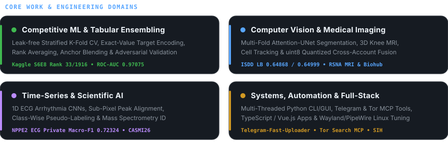
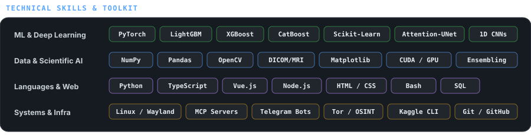

### 🏆 Featured Work

| Project | Highlight | Stack | Link |
|---|---|---|---|
| **Playground Series S6E8** | Rank **474 / 3,532** · Private ROC-AUC `0.97086` | `LightGBM` `XGBoost` `CatBoost` | [`GitHub`](https://github.com/23f3002964/kaggle-playground-s6e8) · [`Kaggle`](https://www.kaggle.com/competitions/playground-series-s6e8) |
| **Industrial Surface Defect** | 5-Fold Attention-UNet + Fine-Tuning · LB `0.64868` | `PyTorch` `Segmentation` | [`GitHub`](https://github.com/23f3002964/kaggle-industrial-surface-defect-detection) · [`Kaggle`](https://www.kaggle.com/adityaraj0612) |
| **NPPE2 ECG Arrhythmia** | True-Aligned 1D CNN + Pseudo-Labeling · `0.72324` | `PyTorch` `1D CNN` | [`GitHub`](https://github.com/23f3002964/kaggle-nppe2-ecg-arrhythmia) · [`Kaggle`](https://www.kaggle.com/adityaraj0612) |
| **Telegram Fast Uploader** | Multi-threaded Linux Nautilus uploader | `Python` `Linux` | [`Telegram-Fast-Uploader`](https://github.com/23f3002964/Telegram-Fast-Uploader) |
| **Darknet Tor Search &amp; MCP** | `.onion` crawler, indexer &amp; MCP server | `Python` `Tor` `MCP` | [`darknet-tor-search`](https://github.com/23f3002964/darknet-tor-search) |
| **AI Counselling System** | Smart India Hackathon (SIH) platform | `TypeScript` | [`AI-Counselling-System`](https://github.com/23f3002964/AI-Counselling-System) |
| **EcoFind** | Sustainability discovery web app | `Vue.js` | [`EcoFind`](https://github.com/23f3002964/EcoFind) |

### 🌐 Live Deployments (Vercel)

| App | Description | Live URL |
|---|---|---|
| **AlphaFold 3 Visualizer** | Interactive AlphaFold 3 model architecture visualizer | [`alphafold3-visualizer.vercel.app`](https://alphafold3-visualizer.vercel.app) |
| **AlexNet Visualizer** | Interactive CNN / AlexNet layer-by-layer visualizer | [`alexnet-visualizer.vercel.app`](https://alexnet-visualizer.vercel.app) |
| **MLT Notes (IITM BS)** | Interactive Machine Learning Techniques study & formula hub | [`mlt-notes-rust.vercel.app`](https://mlt-notes-rust.vercel.app) |
| **Course Platform** | Full-stack online course & learning platform | [`course-platform-delta-lilac.vercel.app`](https://course-platform-delta-lilac.vercel.app) |
| **Truth or Dare** | Interactive web game app | [`truth-dare-blush-ten.vercel.app`](https://truth-dare-blush-ten.vercel.app) |

