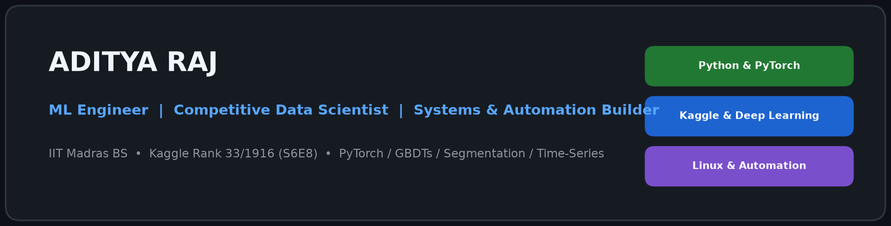
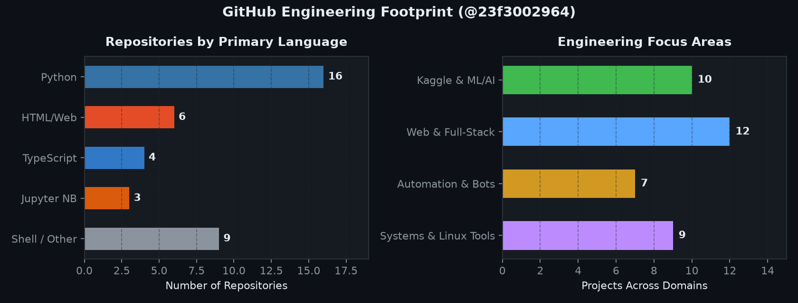

### Hi, I'm **Aditya Raj** 👋

I am a **Machine Learning Engineer**, **Competitive Data Scientist**, and **Systems & Automation Builder** pursuing a **BS in Data Science at IIT Madras**.  
I specialize in high-performance tabular ensembling, medical/industrial computer vision, time-series deep learning, and building fast Python/Linux automation tooling.

---

### What I Do

- 🏆 **Competitive ML & Deep Learning:** Designing leak-free CV pipelines, exact-value target encoding, multi-fold Attention-UNet segmentation, 1D CNNs for physiological signals, and calibrated probability ensembles.
- 🧠 **Medical & Scientific AI:** End-to-end 3D MRI, mass spectrometry, and biological cell-tracking modeling under strict compute and memory constraints.
- ⚡ **Systems, Bots & Linux Tooling:** Multi-threaded CLI/GUI uploaders, Tor/OSINT MCP servers, Telegram workflow bots, and Wayland/PipeWire hardware-accelerated Linux setups.
- 🌐 **Full-Stack Applications:** Modern web platforms built with TypeScript, Vue.js, Python, and scalable APIs.

---

### Featured Kaggle & ML Solutions

| Competition / Project | Domain & Approach | Verified Result | Repository |
|---|---|---|---|
| **Playground Series S6E8** | Tabular GBDTs + Exact-Value TE Forensics + `50-50` Anchor Blend | **Rank 33 / 1,916** · Private ROC-AUC `0.97075` | [`kaggle-playground-s6e8`](https://github.com/23f3002964/kaggle-playground-s6e8) |
| **Industrial Surface Defect Detection** | 5-Fold Attention-UNet + Targeted Fine-Tuning + `uint8` Quantized Fusion | **LB `0.64868`** (`0.64999` budget sweep) | [`kaggle-industrial-surface-defect-detection`](https://github.com/23f3002964/kaggle-industrial-surface-defect-detection) |
| **NPPE2 ECG Heartbeat Arrhythmia** | True-Aligned 1D CNNs + Class-Wise Pseudo-Labeling | **Private Macro-F1 `0.72324`** (`r = 0.9983`) | [`kaggle-nppe2-ecg-arrhythmia`](https://github.com/23f3002964/kaggle-nppe2-ecg-arrhythmia) |

---

### Featured Systems, Automation & Full-Stack Projects

| Project | Description | Stack | Repository |
|---|---|---|---|
| **Telegram Fast Uploader** | High-speed multi-threaded Telegram uploader integrated with Linux Nautilus | Python | [`Telegram-Fast-Uploader`](https://github.com/23f3002964/Telegram-Fast-Uploader) |
| **Darknet Tor Search & MCP** | `.onion` search, crawl, and full-text indexing MCP server | Python · Tor | [`darknet-tor-search`](https://github.com/23f3002964/darknet-tor-search) |
| **AI Counselling System** | Smart India Hackathon (SIH) AI-assisted counselling platform | TypeScript | [`AI-Counselling-System`](https://github.com/23f3002964/AI-Counselling-System) |
| **EcoFind** | Full-stack sustainability web application | Vue.js | [`EcoFind`](https://github.com/23f3002964/EcoFind) |
| **Print Shop Telegram Bot** | Automated document & order management bot for printing shops | Python | [`Bot_teligram_Basak`](https://github.com/23f3002964/Bot_teligram_Basak) |
| **Paper Fetcher** | Automated academic research paper retrieval & organization tool | Python | [`paper-fetcher-`](https://github.com/23f3002964/paper-fetcher-) |

---

### Tech Stack

---

### GitHub Engineering Footprint

