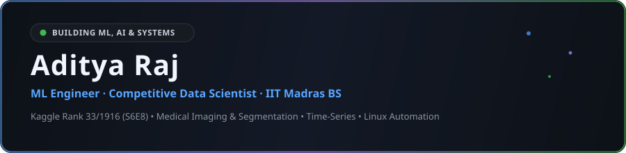

[-20BEFF?style=for-the-badge&logo=kaggle&logoColor=white)](https://github.com/23f3002964/kaggle-playground-s6e8)

### ⚡ About Me

- 🎓 Pursuing **BS in Data Science & Applications** at **IIT Madras**
- 🏆 **Competitive ML Practitioner** — focused on leak-free CV, tabular GBDT ensembling, semantic segmentation, and physiological time-series deep learning
- 🧠 **Medical & Scientific AI** — 3D MRI, mass spectrometry, and biological cell-tracking under strict GPU/VRAM constraints
- 🐧 **Systems & Automation Builder** — multi-threaded Python tooling, Telegram bots, Tor MCP servers, and hardware-accelerated Linux/Wayland setups

### 🏆 Featured Kaggle & ML Solutions

| Competition | Domain & Key Technique | Verified Score | Repository |
|---|---|---|---|
| **Playground Series S6E8** | Frozen 5-fold CV, Exact-Value TE Forensics (`DV-14`), `50-50` Anchor Blend | **Rank 33 / 1,916** · Private `0.97075` | [`kaggle-playground-s6e8`](https://github.com/23f3002964/kaggle-playground-s6e8) |
| **Industrial Surface Defect Detection** | 5-Fold Attention-UNet, `+12`ep Fine-Tuning, `uint8` Quantized Fusion | **LB `0.64868`** (`0.64999` sweep) | [`kaggle-industrial-surface-defect-detection`](https://github.com/23f3002964/kaggle-industrial-surface-defect-detection) |
| **NPPE2 ECG Arrhythmia** | Sub-Pixel Peak Centering (`true-align`), Class-Wise Pseudo-Labeled 1D CNN | **Private Macro-F1 `0.72324`** | [`kaggle-nppe2-ecg-arrhythmia`](https://github.com/23f3002964/kaggle-nppe2-ecg-arrhythmia) |

### 🚀 Featured Systems, Automation & Full-Stack Projects

| Project | What It Does | Stack | Repository |
|---|---|---|---|
| **Telegram Fast Uploader** | Multi-threaded Telegram uploader integrated with Linux Nautilus | `Python` | [`Telegram-Fast-Uploader`](https://github.com/23f3002964/Telegram-Fast-Uploader) |
| **Darknet Tor Search & MCP** | `.onion` crawler, indexer & full-text search MCP server | `Python` · `Tor` | [`darknet-tor-search`](https://github.com/23f3002964/darknet-tor-search) |
| **AI Counselling System** | Smart India Hackathon (SIH) AI-assisted counselling platform | `TypeScript` | [`AI-Counselling-System`](https://github.com/23f3002964/AI-Counselling-System) |
| **EcoFind** | Full-stack sustainability & discovery web application | `Vue.js` | [`EcoFind`](https://github.com/23f3002964/EcoFind) |
| **Print Shop Telegram Bot** | Automated document & order workflow bot for printing shops | `Python` | [`Bot_teligram_Basak`](https://github.com/23f3002964/Bot_teligram_Basak) |
| **Paper Fetcher** | Automated academic research paper retrieval & organization | `Python` | [`paper-fetcher-`](https://github.com/23f3002964/paper-fetcher-) |

### 🛠️ Tech Stack

### 📊 GitHub Engineering Footprint

